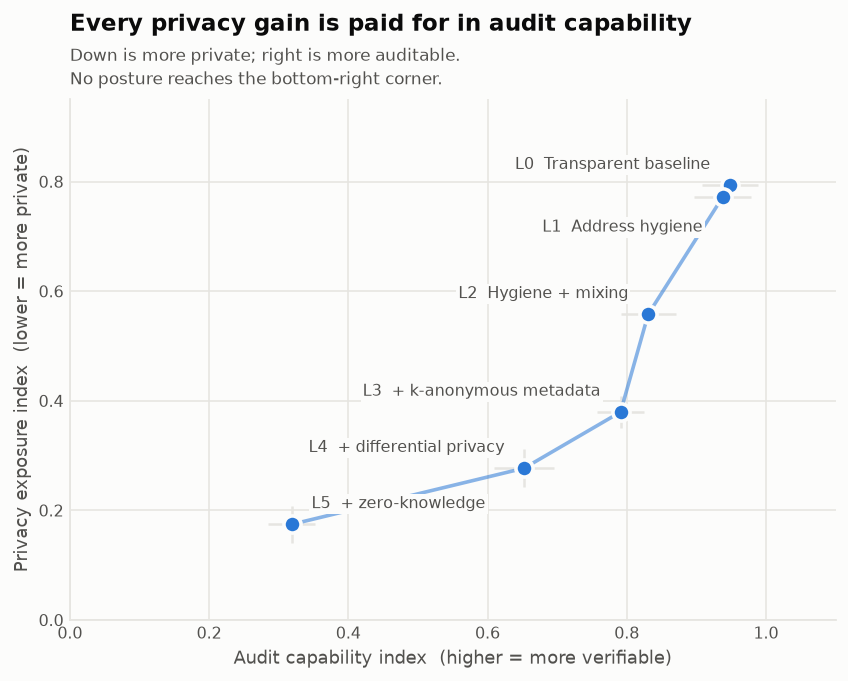
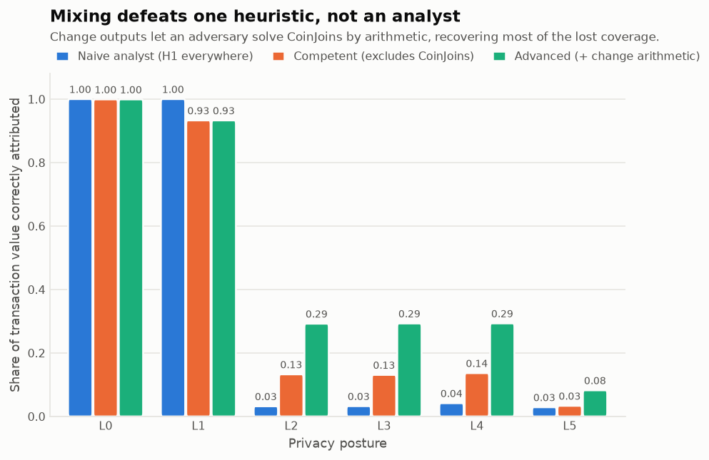
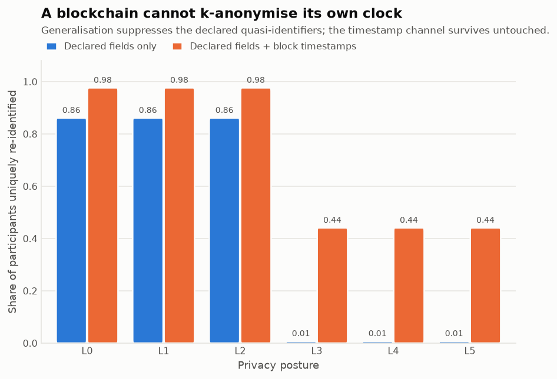
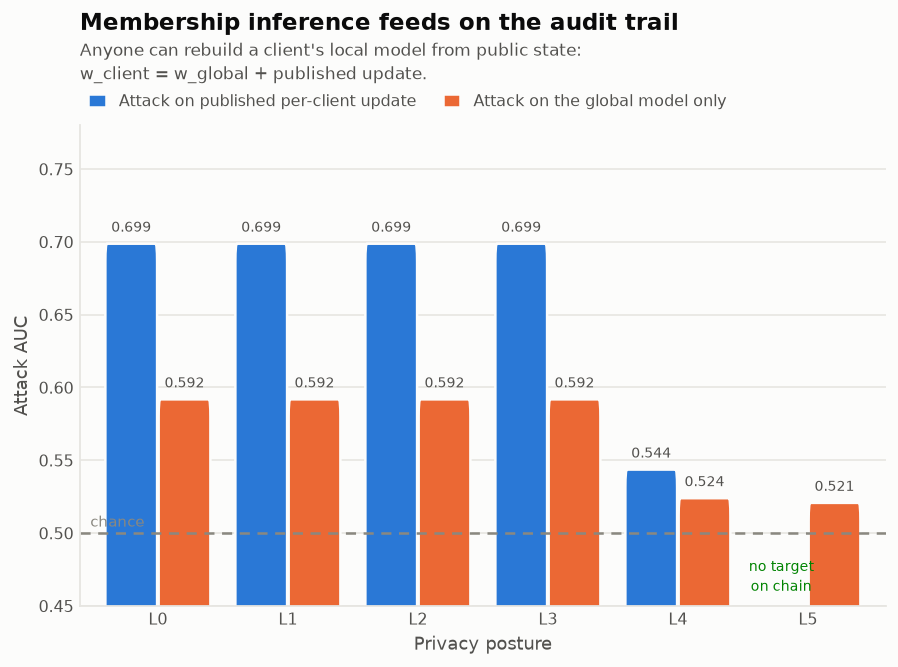
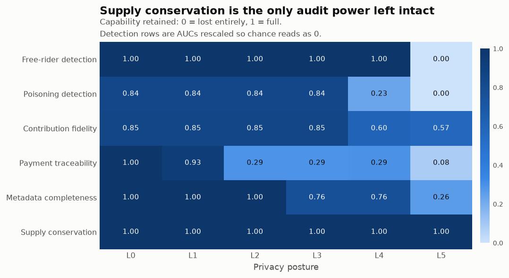
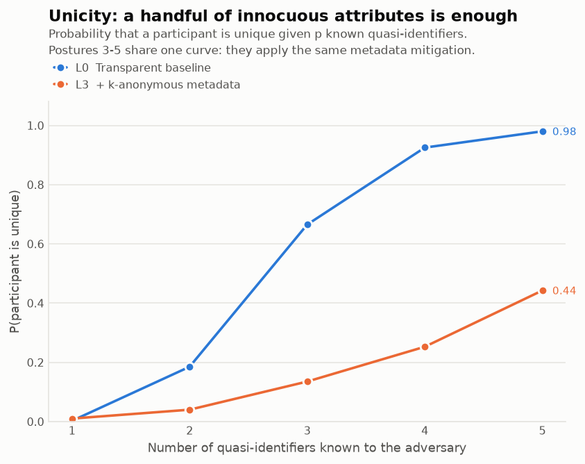
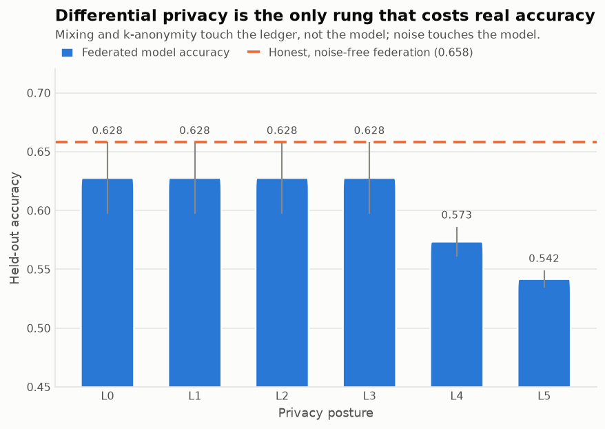

# Privacy and Security Limitations of Blockchain AI

**A quantitative assessment of the transparency/privacy trade-off in on-chain federated learning**

*Assessment date: 2026-09-26 · 5 independent trials per posture · seed 20260926 · all data synthetic*

---

## 1. Executive summary

A public ledger is often proposed as the coordination layer for federated machine learning: participants publish model updates, an aggregator combines them, and the chain provides an immutable audit trail that makes free-riding and poisoning detectable. This assessment builds such a system end to end on synthetic records and attacks it.

The central result is that the audit trail and the attack surface are the same object. Every privacy-enhancing technology evaluated here removes adversarial capability and auditor capability together, in close to equal measure, because both parties read identical bytes.

| Index | L0 (transparent) | L5 (zero-knowledge) | Direction |
|---|---|---|---|
| Privacy exposure index | 0.793 ± 0.014 | 0.174 ± 0.034 | lower is better |
| Audit capability index | 0.949 ± 0.041 | 0.319 ± 0.034 | higher is better |
| Model accuracy | 0.628 ± 0.030 | 0.542 ± 0.007 | honest reference 0.658 |

Moving from the transparent baseline to the strongest posture cuts privacy exposure by 78.0% and audit capability by 66.4%. There is no posture in the ladder that is simultaneously private and auditable; the frontier has no corner solution.

**Headline findings**

1. **Pseudonymity is not privacy.** On the transparent baseline, one known address per organisation attributes 99.9% of all transaction value to a named party.
2. **Address hygiene alone is near-useless.** Rotating to one-time addresses (L1) still leaves 93.3% of value correctly attributed, because change outputs re-link the wallets.
3. **Mixing is defeated by arithmetic, not by guesswork.** CoinJoin cuts a competent analyst's coverage to 13.3%, but solving change outputs against input subsets restores it to 29.2% at 99.1% precision.
4. **A chain cannot k-anonymise its own clock.** Generalisation drops declared-field re-identification from 86.1% to 0.7%, but block timestamps — which consensus requires — put it back to 44.1%.
5. **The audit trail is the membership-inference oracle.** Because `w_client = w_global + published_update`, any observer reconstructs a hospital's local model and tests records against it: AUC 0.699 versus 0.592 against the global model alone.
6. **Differential privacy works, and it is the only rung that costs accuracy.** DP cuts attack AUC to 0.544 but also degrades poisoning detection from 0.921 to 0.614 AUC, and costs 12.7% of model utility.

---

## 2. System under assessment

A decentralised medical-AI marketplace. Hospitals and clinics train a shared clinical risk model by federated averaging; research labs buy inference; data brokers sell datasets; an exchange provides on- and off-ramps. Three record types are published on chain:

- **Payment transactions** (UTXO model) — fees, rewards, purchases.
- **Federated-learning updates** — one record per client per round, carrying a commitment, a claimed sample count and (at lower postures) the update norm and local loss.
- **Inference and listing records** — requester address, model id, a request tag, a fee and an input commitment (never the input).

Scale per trial: 180 entities, 6000 transactions over 90 days, 16 federated clients (3 free-riders, 2 poisoners) over 30 rounds.

### 2.1 Threat model

| Actor | Capability | Goal |
|---|---|---|
| Passive chain observer | Full ledger history; one known address per organisation (KYC record, invoice, published donation address) | De-anonymise payments; re-identify participants |
| Metadata analyst | Ledger plus an external organisational directory (region, size, activity hours) | Match directory entries to on-chain participants |
| Model observer | Global weights and published per-client updates | Infer whether a specific patient record was in a hospital's shard |
| Honest auditor | Exactly the same published records | Detect free-riding, poisoning and misreported contributions |

The auditor is listed deliberately alongside the adversaries. It holds no privileged input. That is the finding, not an oversight in the design.

### 2.2 Privacy postures evaluated

| Level | Posture | Mechanism |
|---|---|---|
| L0 | Transparent baseline | Plain public ledger. Addresses reused, all FL metadata in the clear. |
| L1 | Address hygiene | One-time addresses and change rotation; metadata still public. |
| L2 | Hygiene + mixing | Adds CoinJoin-style joint transactions that break input ownership. |
| L3 | + k-anonymous metadata | FL quasi-identifiers generalised and rare groups suppressed (k=5). |
| L4 | + differential privacy | Clipped client updates with Gaussian noise; counts under Laplace. |
| L5 | + zero-knowledge | Only commitments and validity proofs on chain; no per-client stats. |

---

## 3. Findings

### F1 — Payment de-anonymisation (attack ladder)

Three analysts of increasing competence, all reading public data only.

| Posture | Naive precision | Competent coverage | Advanced (correct value) | Wallets recovered |
|---|---|---|---|---|
| L0 | 1.000 ± 0.000 | 0.999 ± 0.000 | 0.999 ± 0.000 | 0.992 ± 0.011 |
| L1 | 1.000 ± 0.000 | 0.933 ± 0.007 | 0.933 ± 0.007 | 0.796 ± 0.035 |
| L2 | 0.032 ± 0.013 | 0.133 ± 0.008 | 0.292 ± 0.014 | 0.009 ± 0.008 |
| L3 | 0.032 ± 0.011 | 0.131 ± 0.014 | 0.293 ± 0.021 | 0.007 ± 0.007 |
| L4 | 0.042 ± 0.015 | 0.136 ± 0.011 | 0.293 ± 0.010 | 0.011 ± 0.009 |
| L5 | 0.029 ± 0.009 | 0.033 ± 0.004 | 0.082 ± 0.005 | 0.000 ± 0.000 |

The naive analyst applies common-input-ownership to every transaction and is poisoned by CoinJoins — precision collapses to 0.032 at L2. A competent analyst detects joint spends structurally and withholds the heuristic, trading coverage for precision. The advanced analyst then solves each CoinJoin's change output against subsets of its inputs. At L2 that recovers 44.7% of change outputs at 99.1% precision.

> **Root cause.** Equal-denomination outputs hide *which* output is whose, but the change output does not: `change = inputs − denom − fee_share` is an equation an adversary can solve. Production mixers avoid this with uniform, change-free denominations; a naive implementation does not get the privacy it advertises.

### F2 — Re-identification of AI-layer participants

| Posture | Declared fields | + timestamps | Timestamp uplift | Median k | Anonymity entropy (bits) |
|---|---|---|---|---|---|
| L0 | 0.861 ± 0.041 | 0.976 ± 0.000 | +0.115 ± 0.041 | 1.0 ± 0.0 | 0.02 ± 0.00 |
| L1 | 0.861 ± 0.041 | 0.976 ± 0.000 | +0.115 ± 0.041 | 1.0 ± 0.0 | 0.02 ± 0.00 |
| L2 | 0.861 ± 0.041 | 0.976 ± 0.000 | +0.115 ± 0.041 | 1.0 ± 0.0 | 0.02 ± 0.00 |
| L3 | 0.007 ± 0.007 | 0.441 ± 0.097 | +0.434 ± 0.099 | 1.8 ± 0.4 | 0.75 ± 0.19 |
| L4 | 0.007 ± 0.007 | 0.441 ± 0.097 | +0.434 ± 0.099 | 1.8 ± 0.4 | 0.75 ± 0.19 |
| L5 | 0.007 ± 0.007 | 0.441 ± 0.097 | +0.434 ± 0.099 | 1.8 ± 0.4 | 0.75 ± 0.19 |

Quasi-identifiers published by the contract (region, org_size, volume_band, top_model) can be generalised and suppressed, and doing so is effective: declared-field uniqueness falls from 86.1% to 0.7%. Block timestamps cannot be generalised — consensus depends on them — and an adversary who adds the modal activity hour recovers 44.1% uniqueness. The timestamp channel's contribution grows from +0.115 to +0.434 as the suppressible channels are closed: it is the residual, and it is not addressable at the application layer.

Achieving k=5 over the declared fields also required *dropping* attributes entirely. At L5 the chain still publishes `org_size` and `volume_band`, and no longer publishes `region` and `top_model`. With four quasi-identifiers over ~80 organisations, every equivalence class is a singleton and naive suppression blanks the whole table — the curse of dimensionality for k-anonymity (Aggarwal, 2005).

### F3 — Membership inference against published updates

| Posture | Attack mountable | AUC (per-client) | Advantage | TPR @ 1% FPR | AUC (global model) |
|---|---|---|---|---|---|
| L0 | yes | 0.699 ± 0.023 | 0.404 ± 0.043 | 0.008 ± 0.006 | 0.592 ± 0.020 |
| L1 | yes | 0.699 ± 0.023 | 0.404 ± 0.043 | 0.008 ± 0.006 | 0.592 ± 0.020 |
| L2 | yes | 0.699 ± 0.023 | 0.404 ± 0.043 | 0.008 ± 0.006 | 0.592 ± 0.020 |
| L3 | yes | 0.699 ± 0.023 | 0.404 ± 0.043 | 0.008 ± 0.006 | 0.592 ± 0.020 |
| L4 | yes | 0.544 ± 0.021 | 0.097 ± 0.033 | 0.012 ± 0.002 | 0.524 ± 0.016 |
| L5 | **no target** | 0.500 ± 0.000 | 0.000 ± 0.000 | 0.010 ± 0.000 | 0.521 ± 0.010 |

The attack is the standard loss-threshold test. What makes it a blockchain problem is that it needs no privileged access: the global weights are public by necessity and the per-client update is published *as the audit record*, so `w_client = w_global + delta_client` is reconstructible by any observer. Attacking the aggregate alone is far weaker (AUC 0.592 versus 0.699) — the leakage is created by per-client disclosure, which is precisely the feature that makes the system auditable.

> **Caveat on the formal guarantee.** The DP posture reduces the attack empirically (AUC 0.544), but the composed privacy budget over 30 rounds is ε ≈ 34.9 at δ = 1e-5. An epsilon in the tens is far outside any recommended range and should not be presented as a formal guarantee. The observed protection here is empirical, not certified.

### F4 — What the auditor loses

| Posture | Free-rider AUC | Poisoning AUC | Contribution fidelity | Payment traceability | Supply conservation | Audit index |
|---|---|---|---|---|---|---|
| L0 | 1.000 ± 0.000 | 0.921 ± 0.117 | 0.850 ± 0.153 | 0.999 ± 0.000 | 1.000 ± 0.000 | 0.949 ± 0.041 |
| L1 | 1.000 ± 0.000 | 0.921 ± 0.117 | 0.850 ± 0.153 | 0.933 ± 0.007 | 1.000 ± 0.000 | 0.938 ± 0.040 |
| L2 | 1.000 ± 0.000 | 0.921 ± 0.117 | 0.850 ± 0.153 | 0.292 ± 0.014 | 1.000 ± 0.000 | 0.831 ± 0.040 |
| L3 | 1.000 ± 0.000 | 0.921 ± 0.117 | 0.850 ± 0.153 | 0.293 ± 0.021 | 1.000 ± 0.000 | 0.791 ± 0.034 |
| L4 | 1.000 ± 0.000 | 0.614 ± 0.188 | 0.604 ± 0.107 | 0.293 ± 0.010 | 1.000 ± 0.000 | 0.652 ± 0.043 |
| L5 | 0.500 ± 0.000 | 0.500 ± 0.000 | 0.568 ± 0.183 | 0.082 ± 0.005 | 1.000 ± 0.000 | 0.319 ± 0.034 |

Poisoning detection is the first casualty of differential privacy: AUC falls from 0.921 to 0.614, because the noise that hides a client's data also hides the direction of a malicious update. Under secure aggregation (L5) both detectors lose their input entirely and sit at chance.

Contribution fidelity never reaches 1.0 even on the transparent baseline (0.850 ± 0.153): free-riders inflate their claimed sample counts, and nothing on the chain can contradict a self-reported number. Transparency records *claims*; it does not verify them.

**Supply conservation stays at 1.000 at every posture.** It is worth being precise about this: privacy technologies do not dissolve a ledger's integrity guarantees. What they remove is *attribution* — the ability to tie verified value flow to identified parties. Integrity and attribution are different properties and the distinction is often elided in the literature.

### F5 — Utility cost

| Posture | Held-out accuracy | Utility retention | ε (δ=1e-5) |
|---|---|---|---|
| L0 | 0.628 ± 0.030 | 0.954 ± 0.026 | — |
| L1 | 0.628 ± 0.030 | 0.954 ± 0.026 | — |
| L2 | 0.628 ± 0.030 | 0.954 ± 0.026 | — |
| L3 | 0.628 ± 0.030 | 0.954 ± 0.026 | — |
| L4 | 0.573 ± 0.013 | 0.873 ± 0.045 | 34.9 |
| L5 | 0.542 ± 0.007 | 0.825 ± 0.044 | 34.9 |

Ledger-layer mitigations (address hygiene, mixing) and metadata generalisation cost no accuracy at all — they never touch the training signal. Only gradient noise does, and it costs 17.5% of the honest federation's accuracy at the strongest posture. Any claim that privacy is 'free' in such a system is a claim about which layer the mitigation sits in, not about privacy.

---

## 4. Risk register

| ID | Risk | Likelihood | Impact | Severity | Evidence | Residual / mitigation |
|---|---|---|---|---|---|---|
| R1 | Payment graph de-anonymisation via address clustering | High | High | **Critical** | 99.9% of value attributed at L0 | Reduced to 8.2% at L5 |
| R2 | CoinJoin defeated by change-output arithmetic | High | High | **Critical** | 44.7% solved at 99.1% precision | Use uniform, change-free denominations; otherwise unmitigated |
| R3 | Participant re-identification via block timestamps | High | Medium | **High** | 44.1% unique even at L5 | Not addressable on-chain; requires submission-time randomisation |
| R4 | Membership inference on patient records via published updates | High | High | **Critical** | AUC 0.699, TPR@1%FPR 0.008 | AUC 0.544 under DP; eliminated under secure aggregation |
| R5 | Undetected model poisoning once updates are hidden or noised | Medium | High | **High** | Detection AUC 0.614 at L4, 0.500 at L5 | Requires ZK range/norm proofs, not plaintext inspection |
| R6 | Free-riding on inflated self-reported contributions | High | Medium | **High** | Contribution fidelity 0.850 even with full transparency | Needs proof-of-training, not disclosure |
| R7 | Immutability makes disclosure permanent and irrevocable | High | High | **Critical** | Every record above is retained indefinitely by construction | No technical mitigation; only non-publication |

---

## 5. Mitigation effectiveness

| Posture | Δ privacy exposure | Δ audit capability | Δ utility | Privacy gained per unit of audit lost |
|---|---|---|---|---|
| L1 | -0.022 | -0.011 | +0.000 | 2.00 |
| L2 | -0.236 | -0.118 | +0.000 | 2.00 |
| L3 | -0.414 | -0.158 | +0.000 | 2.63 |
| L4 | -0.516 | -0.296 | -0.081 | 1.74 |
| L5 | -0.619 | -0.630 | -0.129 | 0.98 |

A ratio above 1.0 means the posture buys more privacy than it costs in auditability. Read this table as the design question the system architect actually faces, not as a ranking: the right posture depends on whether the deployment's dominant risk is patient re-identification or undetected model corruption.

---

## 6. Limitations and threats to validity

- **Synthetic data throughout.** No real chain or patient data is used. Absolute numbers depend on the generator's parameters; the *ordering* of postures and the mechanisms behind each finding are the transferable results, not the specific percentages.
- **The generator encodes the assumptions the attacks exploit.** Round-number payments, per-contributor CoinJoin change and role-based activity clocks are modelled because real systems exhibit them, but their strength here is a modelling choice. A deployment with change-free mixing would not show F1's recovery.
- **Small federation.** 16 clients with 2 poisoners makes the poisoning-detection AUC coarse; this is why every figure is averaged over 5 independent worlds and reported with a standard deviation.
- **One model family.** Logistic regression over random Fourier features was chosen because it memorises measurably. Deep networks generally leak more, so F3 should be read as a lower bound.
- **The indices are unweighted means.** The privacy-exposure and audit-capability indices average their components equally. They are summaries for comparison across postures, not calibrated risk scores; the component tables are the evidence.
- **ZK is modelled by omission.** Posture 5 simulates zero-knowledge proofs by withholding data and asserting validity. Real proof systems have their own trusted-setup, soundness and cost properties that this assessment does not evaluate.

---

## 7. Recommendations

1. **Do not treat an on-chain audit trail as privacy-neutral.** Per-client disclosure is what makes both auditing and membership inference possible. Decide which one the deployment needs before choosing what to publish.
2. **Publish proofs, not statistics.** The only posture that breaks the symmetry is one where the auditor verifies a *property* (norm bounds, honest training, sample-count ranges) without reading the underlying value. Every posture that publishes a number hands the adversary the same number.
3. **If mixing is used, use change-free uniform denominations.** F1 shows a change-emitting mixer surrenders most of its anonymity set to arithmetic alone.
4. **Randomise submission times.** Timestamps are the one quasi-identifier no application-layer mitigation reaches. Batched or jittered submission windows are the only lever, and they trade against protocol latency.
5. **Do not quote an epsilon without composing it.** The DP posture here reaches ε ≈ 34.9 over 30 rounds. Report composed budgets, or report the empirical attack result and say so.
6. **Treat immutability as a privacy hazard in its own right.** Every other risk in the register is permanent by construction; a re-identification that is infeasible today remains available to every future adversary against the same stored bytes.

---

## 8. Reproducing this assessment

```bash
python -m venv .venv && .venv/bin/pip install -r requirements.txt
.venv/bin/python run_all.py --trials 5
```

Artefacts:

- `outputs/data/results.csv` — aggregated metrics (mean and std)
- `outputs/data/results_raw.csv` — one row per posture per trial
- `outputs/data/detail.json` — full per-posture attack reports
- `outputs/data/L*_*.csv` — the synthetic records themselves
- `outputs/figures/` — figures 1–7

### Figures



*The trade-off frontier: privacy exposure against audit capability.*



*Payment de-anonymisation under three levels of analyst competence.*



*Re-identification with and without the block-timestamp channel.*



*Membership inference against published updates versus the global model.*



*Which audit capabilities each posture retains.*



*Unicity: probability of being unique given p known quasi-identifiers.*



*Model accuracy across postures against the honest-federation reference.*
